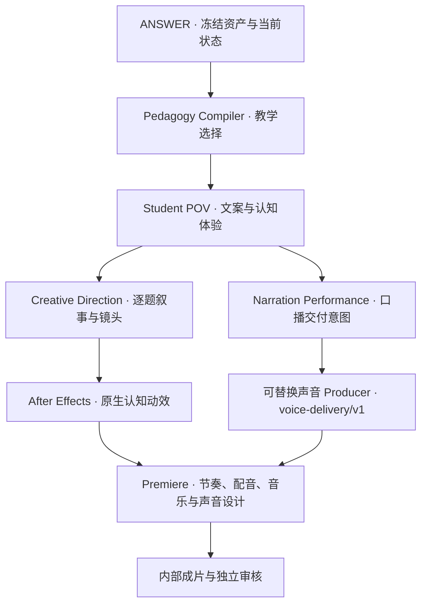

# video-making

**把真实做题过程拍成可观看、可追溯的认知动作影片。**

以 ANSWER 的冻结教学资产为基础，连接教学选择、学生第一视角文案、导演、声音和原生 AE → Premiere 制作。观众先看到原题，再跟随注意力和实际动作，看到证据如何改变当前判断。

**方法组织整期，题目驱动叙事，动作推动镜头，证据支撑判断，认知突破产生爽感。**

## 产品方向

| 产品 | 第一目标 | 内容组织 |
|---|---|---|
| **FREE_SHOWCASE · Experience First** | 观看体验、认知爽感、传播力 | 一种核心方法贯穿一期；优先用 2–3 道不同真实题目形成递进，每题独立完成做题叙事 |
| **PAID_MASTERY · Rigour First** | 方法掌握、独立执行、迁移 | 系统覆盖适用条件、动作、边界、反例、组合、练习与反馈 |

当前制作重点是 FREE_SHOWCASE 内部样片。片长由阅读、动作、思考和口播决定，**没有时长上限**。Fast Pass、局部 Guided Replay 和现场引导按每题需要安排，不机械重复整题两遍。

两种产品共用真实性和来源底线，使用各自的质量审核标准。详见[双轨内容策略](docs/content-profiles.md)与[自适应双速导演验收](ADAPTIVE_DUAL_SPEED_DIRECTION_ACCEPTANCE.md)。

## 制作链路



ANSWER 提供教学事实与生命周期。Video OS 只消费冻结结构化输出和显式状态清单，不从 Registry、教学 Markdown 或原始题库补推断；教学疑点交回上游。认知设计研究辅助呈现决策，不成为第二个教学事实源。

公开放行绑定当前依赖、最终文案、实际展示内容和最终媒体，要求教学、来源与编辑审核同时通过。工程检查、真人观看、试听、教学效果和传播结果分别记录。

## 当前进展 · 2026-10-11

| 模块或产出 | 当前状态 |
|---|---|
| Frozen Asset / Video OS | 冻结导出、状态投影、引用绑定、分层门禁与失效传播已有实现 |
| Pedagogy / Student POV | 0.3 兼容链保留；0.4 Plan / Handoff 与体验层通过显式契约接入 |
| 第一视角画面 | Swiss Cognitive POV、注意力扫读、透明提取、物理剥离、方法接力与局部重放持续迭代 |
| 声音消费 | 稳定使用 `voice-delivery/v1`；当前 Producer 为 GPT-SoVITS，口播计划与 Premiere 节奏控制独立 |
| 知识辅助改稿 | Astra 完成选题、分镜与文案改稿；根代理复核冻结动作、证据与结论范围，见[改稿记录](COGNITIVE_DESIGN_CREATIVE_REVISION.md) |
| 最新双题试制 | R06 主题，两道不同真实题；原生 AE **9,051 帧、3840×2160、24 fps**，完整带字幕纯画面已封装并全片解码核验，时长 **6 分 17.125 秒** |
| 最新声音与成片 | 19 条逐字配音及音乐素材已准备；新版原生 Premiere 合成与最终有声交付待完成，试听暂缓 |
| 人工体验与公开资格 | 新双题版完整观看审核待进行；`public_render_ready=false` |

本轮双题片的第一题展示已有的局部候选排除，第二题逐项消费已有动作后才呈现上游闭合答案。候选保留不直接变成定案，辅助动作不借用主方法归因。此轮未修改 ANSWER、Registry 或冻结教学事实。

最新画面封装是知识辅助改稿之后的制作进展；历史验收文件保留各自日期、输入与阶段，不将旧版本认可移给新版。当前进展不等于新影片的人工观看或听感通过。

## 视觉与声音

- **Swiss Cognitive POV**：克制、典雅、有张力；构图和运动服务正在发生的认知动作。
- **第一视角做题**：原题先出现，下一步强调的对象提前可见；画面呈现当前注意和记住的信息。
- **有据的视觉事件**：抽离、重组、比较、候选收缩与证据锁定发生在实际动作节点。
- **统一高亮**：题干关键词橙色，比对过程蓝色，命中橙色；用短暂高亮表达注意力。
- **统一 4K 横版**：新制预览和交付使用 3840×2160、16:9，核验原生与实际编码规格。
- **声音服务思考**：进入、搜索、执行、判断、释放和收束；新 take 单独试听，不继承旧声音认可。

入口：[第一视角电影化做题](docs/first-person-solving-cinema.md) · [Swiss Cognitive POV](docs/swiss-cognitive-pov.md) · [Motion Identity](creative/motion-identity/motion-identity.md) · [口播表演层](creative/voice-performance/README.md) · [4K 规格](docs/video-resolution.md)。

## 模块导航

| 入口 | 用途 |
|---|---|
| [Video OS](docs/video-os.md) | 冻结消费、评分、生产包、发布审核与上游失效 |
| [Pedagogy Compiler](docs/pedagogy-compiler.md) | 第一动作、教学选择、Work Delta、Payoff 与边界交接 |
| [Student POV Copy](docs/student-pov-copy.md) / [体验层](docs/student-pov-experience.md) | 自然执行语言、认知路径、Copy Audit 与体验编排 |
| [原题绑定](docs/original-question-copy-contract.md) | 未填答原题、持续题面与最终文案指纹 |
| [Creative OS](creative/README.md) / [Cognitive Direction](docs/cognitive-direction-v02.md) | 冻结文案、叙事、动作和镜头规划 |
| [AE Production](ae/README.md) / [原生 Episode 执行器](ae/experiments/adaptive-episode/README.md) | 官方桥接、原生工程、关键帧审计、分批渲染和画面封装 |
| [Voice Packs](voicepacks/README.md) / [声音试听交付](docs/student-pov-voice-preview.md) | 可替换 Producer、逐字文稿、音频指纹与试听状态 |
| [Premiere 配置记录](PREMIERE_SETUP_ACCEPTANCE.md) | 原生编辑连接与配置验收 |
| [模块交接](docs/module-integration.md) | ANSWER 源码接口、兼容与开发交接 |

认知设计知识库及自动接入的增量仍在本地并行开发；当前公开首页通过已提交的改稿记录说明实际消费与证据范围。

## 本地运行

Python **3.10+**，从完整仓库源码目录运行：

```powershell
python -m pip install -r requirements-dev.txt
python -m answer_engine validate
python -m answer_engine analyze examples/question-action-course.json --renderer structured
python -m unittest discover -s tests -v
```

已有冻结记录通过显式请求导出：

```powershell
python -m answer_engine export-asset <export-request.json>
python -m answer_engine export-status <export-request.json>
```

内部 Episode 的原生制作入口：

```powershell
python ae/experiments/adaptive-episode/run.py audit local-data/<revision>
python ae/experiments/adaptive-episode/run.py render local-data/<revision> --pid <AE-PID> --hwnd <AE-window>
python ae/experiments/adaptive-episode/run.py package local-data/<revision>
```

实际制作需要相应冻结请求、字体、声音文件、Adobe 应用与已连接的官方桥接。输入形状、构建步骤和回放要求见各模块文档；示例和合成测试不代表真实学生效果。

## 公开仓库与本地产物

公开仓库保存代码、Schema、工作流、脱敏报告及明确标记的合成测试样本。真实题面、冻结真题资产、视频、配音、音乐、模型和 Adobe 工程保留在忽略的 `local-data/` 或本地媒体目录，**不上传视频**。

渲染进度统一由低档 subagent 只读追踪；制作、异常恢复与最终核验由主代理负责。旧版本独立保留绑定，重渲染或更换配音后重新核验时间线和媒体。

ANSWER Method Engine 是仓库内保留的教学核心源码。其方法执行、宿主审阅、整篇讲解与真实材料导入分别见[方法执行](docs/method-execution.md)、[单题审阅](docs/lesson-review.md)、[整篇接口](docs/passage-lesson.md)和[试卷导入](docs/exam-ingestion.md)。本仓库的增量不自动修改 `rockpunkgod/ANSWER` 源仓库。
