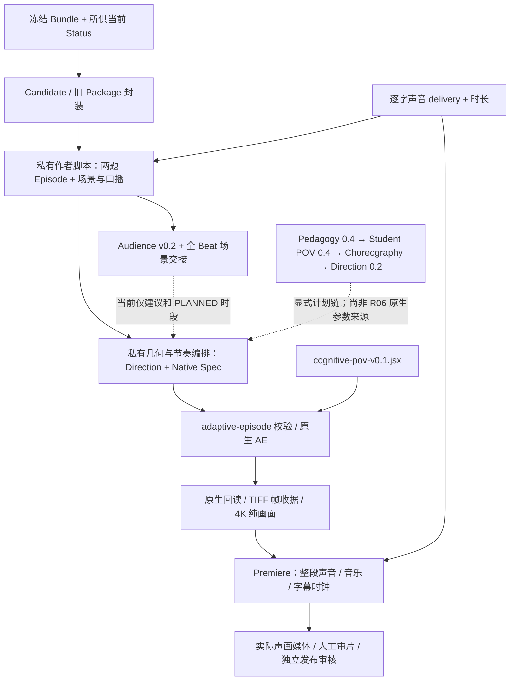
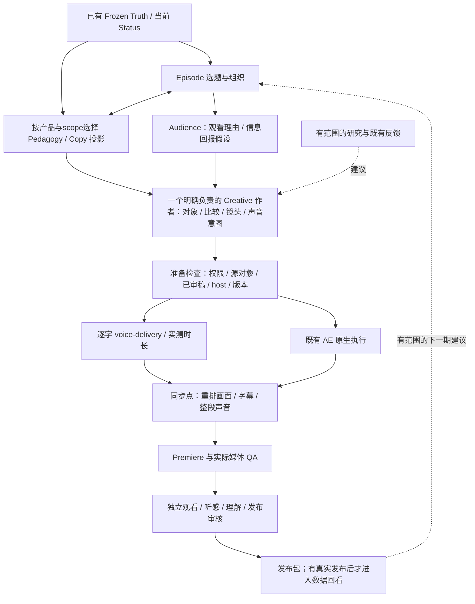

# 当前 FREE_SHOWCASE 生产入口

从本页进入当前制作；模块权限见[职责矩阵](MODULE_OWNERSHIP_MATRIX.md)，逐项能力与证据见[能力索引](PRODUCTION_CAPABILITY_INDEX.json)，本次核查记录见[审计报告](WORKFLOW_AUDIT.md)。本页是操作导航，不增加 Runtime、必填生产表或发布门禁。

原始审计基线：`main@d9fa2da8bf893745f567e21cb631a4d43299c110`；文档整理已提交于 `c97c16b`。后续制作状态在本页增量更新，原始[审计报告](WORKFLOW_AUDIT.md)保留当时事实。本机研究/Cinema 增量继续独立保留。继续任何生产前读取该 revision 的实际收据与当前提供的上游状态，不凭目录名字或本页日期推定有效。

## 当前主片整合入口

当前唯一主片 revision 为 `local-data/free-showcase/mainfilm-integration-r01/`，由私有 `local-data/free-showcase/PRODUCTION_INDEX.json` 指向。继续制作使用原有 `python -X utf8 ae/experiments/adaptive-episode/run.py`；不带目录时读取该指针，不回到历史 R06、163 秒粗剪或局部试片。`status / check / voice / align / prepare / build / audit / preview / render / premiere / package / restore` 都消费同一 revision。真实输入缺失时明确报错，公共克隆不凭本页生成题材。

本轮用户明确要求形成同一版连续声画粗剪，替代此前“交局部试片后暂停扩展”的任务边界；不继承整期认可或发布许可。已核实两题当前冻结资产及完整候选结论，新稿按来源由作者核查，独立新稿审阅、听审与人工作品审片仍另记。目标为约 5–8 分钟，最终时长取完整声音及实际阅读/动作，不填充或加速凑数。

父版本 `first-release-rescue-r02` 的 163 秒双题粗剪及其叙事节奏反馈保留原范围。`longform-director-r01` 提供连续新稿与 30/77 秒对照，`longform-director-r02-locator` 提供 83 秒定位修正；它们是当前主片的输入或对照，不再各自代表当前全局版本。77 秒片实际反馈指出定位过程没有被看见；83 秒修正版尚未获得复看认可。旧 R06 / B06 章节保留历史证据，不作为本次继续制作指令。

推荐依次使用 `check → voice → align → prepare → build → audit → preview → render --proof → render → premiere → package → restore`。先查看现有收据；已完成的完整声音及原生分段按指纹复用，不能再次执行 build 覆盖项目。`--proof` 只先渲染同一主片的开场，后续整片复用这些帧，不另建实验版本。输出统一标记 `EDITORIAL_PROXY`；4K 合成与正式 4K 渲染分开记录。

### 本轮实际交付与接手点

同一目录已生成 `MAIN_FILM_EDITORIAL_PROXY.mp4`：**293.458333 秒、7,043 帧、1920×1080、24fps**，含两题完整核对、一次重点回看、24 段完整新声音及音频对齐字幕。`MAIN_FILM.aep` 保存当前代理与未渲染的 4K24 主合成；`MAIN_FILM.prproj` 保存实际声画剪辑。`DELIVERY_QA.json`、`native-audit.json`、`PR_TIMELINE.json` 是对应当前版本的执行依据，不是人工认可。

实际观看路径：00:10–00:19 展示产品名从题干到原文同名对象及整个产品段；约 01:15 先展示原题中的 D，再连续带入工作空间；01:50.667–02:18 只回看一次价格比较关系；02:18 后进入第二题，最后完成四项核对与 D 的答案落定。原题/工作空间、真实相机、整项字母身份、透明提取和物理退出均有原生及编码帧检查。`D-entry-regression/` 对照的是已有明确反馈的 18 秒 B 片，认可范围没有转授本片。

原生回归修复了提前变灰的候选、段落被标题裁切、Orientation 切线把角度清零，以及 D 原位辨认没有被镜头看见的问题。D 的修复保持所有声音、字幕、判断时刻和总时长；段外 6,447 帧相机读回完全一致，14 个完整渲染分段复用，仅重做两个受影响分段。旧尝试保存在 `native-attempt-01/02`，声音漏读和导出失败记录也保留。

实际 PR 导出存在统一的 1,024 样本（约 0.021333 秒）延迟；`package` 先逐段测量，只接受零延迟或这一明确的 AAC 帧偏移，再仅修正封装时间戳。最终每段完整声音在实际起点的相关性均高于 0.99999；视频包与时间戳不变，音频编码包不变。字幕对齐、完整解码和相关回归已核验；**未运行全仓测试**，也没有将既有独立失败改为通过。

本版仍是旁白粗剪：**正式 4K 输出、音乐/音效混音、整片受控景深精修、独立新稿审阅、人工完整观看与试听、学生效果及发布资格尚未完成**。当前 AE 相机保留三维运动与运动模糊，DOF 关闭；这不把历史零景深设定升为全局要求。快移过程中纸面与暗色空间的文字对比、全片节奏、英文名称和选项字母读音仍需随最终媒体复核；抽帧与 ASR 不代签这些判断。

接手先播放当前 MP4 并读取上述收据；需要继续原生编辑时打开同目录 AEP/PR 工程，不重跑 build。宿主恢复父工程的结果见 `RESTORED_HOSTS.json`，此前工程和媒体继续保留。下一次修改只针对新反馈涉及的台词或镜头，其余有效要求按本页继续继承。

### 要求实际进入哪里

| 有效要求 / 当前状态 | 实际输入或作者决定 | 当前消费者 | 作品变化与证据 |
|---|---|---|---|
| 两题递进、完整候选、核心方法只重点拆一次 / 有效 | `AV_AUTHOR.json` 的两题来源、15 场连续故事、完整 terminal refs | `authored_episode.checked_author / compile_clock` | 逐题四项检查后才给最终选项；重点回看只一次、不重复排除。冻结与状态检查不是作者自造答案 |
| 观看理由和自然叙事 / 有效，新稿观感未确认 | 先写成完整稿，再拆精确台词；题间由表达不同转为名词相同但动作不同 | 同一作者输入中的 `voices / scenes / attention / candidate_anchor` → 原生模板与声音 | 台词进入新 take；明确的口播锚点改变提示和候选入场。Audience 模块本身仍非自动镜头编译器，作者决策已进入消费者 |
| 题干到原文定位 / 实际缺失反馈后的有效修正 | 同名对象、原文精确范围、辨认停留 | `compile_clock` → `authored-episode.jsx` 的原生定位镜头 | 先看题干对象，再从文章开头找同名对象、确认整个段落，随后才提取证据；新媒体仍须复看 |
| 原生 3D、来源提取、整项物理退出 / 有效 | 从已执行私有编排提取的原位复制、父层运动、深度与遮挡、源字返回 | 原有 adaptive 入口 → `authored_native` → 同一 AE 工程 | 原文字句、来源、候选字母与完整选项核对；相机和提取共用移动时钟。工程检查不代签空间感 |
| 单次重点回看 / 有效 | `kind=replay / replay_of` 和已闭合候选状态 | `compile_clock` 与原生 replay 场景 | 回看第一题价格关系的比较对象；不重复整题、不开新的候选事件 |
| 改稿必须改声音/字幕/时间 / 有效 | 同一个逐字稿、已有 GPT-SoVITS Producer、`voice-delivery/v1`、实际声音对齐 | `voice → align → prepare`，随后 AE 字幕与 PR 完整音轨 | 每段完整 take、无剪短/变速；时长改变传播到后续场景、字幕和判断。ASR 差异不伪装听审通过 |
| A/C 视觉方向 / 历史探索范围 | v0.4 的 A=Paper/Evidence，C=Fog/Architecture；后来 G/H/I 与连续空间试片另有范围 | 本轮保留兼容的纸面、克制层级与空间连续；不自动启用旧字母预设 | 原定义见 `ae/design/swiss-cinematic-hero-v0.4.json`。未找到把 A/C 两套整体升为当前全片认可的凭证，不猜方案或恢复旧固定构图 |
| Pedagogy / Student POV / Choreography / Direction 0.2 | 既有独立设计链和来源职责保持 | 没有强制导入这些尚未提供适配输入的历史编译器 | 本轮由显式作者输入兑现自然文案、辨认和动作；这些模块本体不因主片产出而被标为已接通 |

`audience_intent` 记录作者的观看理由，本身不是自动导演参数。实际改变作品的是同场逐字稿、辨认/落稳时机、口播锚点、来源范围和相机实现；不能仅凭理由字段或其 hash 宣称观看意图已兑现。当前作者输入也不是旧 Episode/Pedagogy 编译器的输出，现有模块各自的集成范围保持原记录。

### 后续新增或修改板块

只引用本页“制作要求的延续”，不复制第二份全局清单。每次指出改变的有效要求、继续适用的旧要求、具体消费者、预期作品变化和相关回归；用户没有明确替代的兼容要求继续有效。实验默认值不改全局默认。改台词重新生成受影响 take；改声音重新准备字幕和时钟；改排版检查提取、遮挡和相机；改节奏检查证据、候选和停留。已有 native 输出后发现输入改变时明确报 stale，另存制作修订，不靠刷新 hash 冒充旧输出有效。

代码状态、原生执行、媒体交付、人工创意、听感、学生效果和公开资格继续分别记录。当前工程消费关系见 `ae_production/authored_episode.py`、`ae_production/authored_native.py` 和 `ae/templates/authored-episode.jsx`；本页下方旧路径是历史范围，不取消当前主片要求。

## 制作要求的延续

2026-10-11，用户认可 D 连续入场修订后强调“之前的3D感和镜头感不要丢了”，并要求“之前的一些和这个不冲突的要求不要丢了”。新反馈增量作用于旧要求；一次入场或排版修订不重置整套创作方向。下表用于制作交接和实际审片，不增加 Runtime 或程序门禁。

| 已确定的要求 | 后续制作如何保留 |
|---|---|
| FREE_SHOWCASE · Experience First；PAID_MASTERY · Rigour First | 免费版优先高手做题的观看体验与有据爽点，付费版优先掌握与迁移；两者共同保留教学真实性和实际来源底线 |
| 方法组织整期，题目驱动叙事 | 整期优先2–3道独立真实题形成递进；每题自己的任务、动作、证据和结果清楚，必要辅助方法自然接力、各动作贡献归属准确。限定单题镜头试验仍按其已有范围制作 |
| Swiss：克制、典雅、有张力 | 清晰的层级和构图变化服务认知事件；适度色彩与物理冲击有明确表达用途。保留已经认可的运动质感 |
| Reality Layer + Cognitive Space | 原题是持续存在的世界；发现的原词从原位进入临时工作空间，比较后自然返回原题。下一步关注的对象先在场，再改变显著程度 |
| 第一视角做题与记忆信息 | 焦点表现当前注意力，前景承载当下记住和正在操作的信息；不把搜索拍成教师给试卷逐步加批注 |
| 题干 → 完整原文 → 命中证据 | 先明确题干搜索线索，再在已有完整原文中搜索、辨认、确认整句，然后连续提取交给后续动作；定位词按有效冻结轨迹，不默认全是谓语 |
| 统一注意力色彩 | 题干关键词橙色，比对过程蓝色，命中橙色；沿用短暂高亮，不改成划线 |
| 丝滑的注意力镜头 | 保留苹果式轻微放大与行间连续过渡；候选间快移、识别时减速、命中后落稳，速度由当前搜索事件驱动，避免弹跳和顿挫 |
| 原生3D与电影镜头 | 保留原题/工作空间深度、真实相机与焦点变化、透视、物理提取和运动模糊；文字整齐是在3D空间内整理。景深适度、阅读状态清楚 |
| 透明提取与整齐文字 | 提取的是已有原字，不附带新的不透明卡片底；维持来源连续性、统一字形基线、清楚分组与阅读落位。D保留本次已认可的原位辨认和连续移入 |
| 认知突破推动动作 | 先看见比较依据和差异，再执行已审判断。强视觉变化由真实认知变化触发；剥离前先识别，剥离动作利落，动作间保留辨认节奏 |
| 自然引导与三层分工 | VO推进思考和执行，Screen呈现原词与依据，Motion表现关系变化；围绕这道题说自然的话，避免机械字段朗读、重复提醒和三层同步复述 |
| C端只看需要的信息 | 不显示R02等内部方法编号；方法名在实际动作价值之后简短出现。必要限定通过具体检查自然表达，结论范围仍由冻结事实决定 |
| 自适应速度与无时长上限 | 按阅读和判断需要安排Fast Pass及局部Guided Replay，不机械整题双遍；允许Payoff后停一拍，不为凑时长补解释 |
| 4K与既有生产链 | 当前原生证明保持3840×2160、24fps；后续正式画面保持4K。复用AE／Premiere与现有声音消费接口，声音变化同步重算画面、字幕和时间线 |
| 既有声音和音乐方向 | 已选声音模型、逐字文案与可替换voice-delivery保持；声音服务清晰、聪明、自然的做题推进，肖邦服务典雅。当前无声视觉试片不自动加入声音或继承旧听感认可 |
| 冻结事实与反馈范围 | 不改变ANSWER、Registry、已冻结Evidence/Action/Stop/Role或答案。每项反馈绑定对应媒体与镜头范围，保留历史项目；代码/工作流入库，真实题材和媒体留本地 |

本次连续镜头B为后续视觉基线，固定镜头A只用于对照。具体反馈与逐帧保留依据见[D连续入场记录](../../REALITY_COGNITIVE_ENTRY_ACCEPTANCE.md)，原生执行见[Fast-Pass工作流](../../ae/experiments/reality-cognitive-fast/README.md)。接手时核对哪些既有要求仍适用、哪些受本次改动影响，再检查真实媒体；整理排版不构成取消镜头和空间表达的授权。

若历史试片说明与后续明确指令冲突，以后续指令为准：历史单题短格式时长、固定光轴/零景深及整题固定双遍不是当前全局要求。其工程和收据保留用于重放，不带回已经被修正的默认值。尚未观看的新镜头仍需实际确认，不能把延续方向等同于新媒体通过。

## 接手时先做哪一步

1. 核对 HEAD、工作树及实际任务 revision；保留并行工作。当前主片从 `local-data/free-showcase/PRODUCTION_INDEX.json` 进入，父粗剪为 `first-release-rescue-r02`。仅在显式继续旧 R06 / B06 专项时读取其原 revision。真实材料不随 Git 分发；缺失时记录 `LOCAL_PRODUCTION_EVIDENCE_UNAVAILABLE`。
2. 已有产物先读收据、依赖和失败原因。B06 **不要重新运行 prepare/G0**：从 `PREPARATION_RECEIPT.json`、`PRODUCTION_INDEX.json`、`CANDIDATE_PREFIX.json`、`ANNOTATION_REQUEST.json` 开始。
3. 确认产品为 `FREE_SHOWCASE`。`PAID_MASTERY` 转到其教学目标、练习和迁移设计；当前免费发布检查器明确拒绝 Paid，尚无完整 Paid 课程验收实现。
4. 找到本次真正缺少的一层再继续。没有新上游语义许可时不制作新的语义拆分；有许可也仍需消费者、原生执行和实际媒体核验。
5. Adobe 操作归正在制作的唯一执行者。审计与研究代理不切换项目、不启动制作。不因锁文件存在就认定写入受保护。

历史 R06 是内部制作：完整带字幕纯画面已经存在，十九条逐字声音已准备；原审计基线未发现该 revision 的完整原生 PR 声画交付与最终审核。其 `public_render_ready=false`。这些事实不否定 R02 当前首发、历史 R09 或 Reading D 的各自交付。

## 历史 R06：当时真正执行过的路径



图中虚线是尚未完成的自动消费关系；完整 R06 的 PR 声画与最终审核仍待完成。B06 的限定片段另有原生序列和导出收据，见下节；不能由局部产出推定整期已交付。

真实作者在忽略目录：`prepare_title_task_episode.py` 读取两套冻结资产及已写好的场景/声音，调用 `build_draft(..., 'P02', 60)` 与 `finalize_copy` 复用旧 Package，再独立编排长 Episode、候选事件、字形坐标、口播位置和字幕。旧短格式结果被保留，不作为整期时长限制。之后 `refine_title_read_cues.py` 与 `refine_title_candidate_holds.py` 形成 r2/r3。它们包含具体案例路径和 Adobe 修改，**是历史作者证据，不是通用重放命令**。故障恢复脚本中的旧 recovery ID 更不能用于新会话。

实际执行器为 [adaptive-episode/run.py](../../ae/experiments/adaptive-episode/run.py)，实际模板为 [cognitive-pov-v0.1.jsx](../../ae/templates/cognitive-pov-v0.1.jsx)。`current(folder)` 重核输入文件 SHA、Episode/Status、全部候选动作与答案闭合、文字来源和声音 SHA；原生 audit 再核字形、对象身份及关键帧。它没有调用 `compile_direction()`，也没有消费 `director_handoff()` 的输出。

R06 的 AEP、Native Spec、实际帧和画面收据是执行证据；`DIRECTION_REALIZED.json` 这个文件名本身不证明实际媒体时码。[Audience 交接](../../creative_os/audience_engagement.py) 的时间明确仍为 `PLANNED_NATIVE_DIRECTION_NOT_ACTUAL_EXPORT`。

## 历史 R06/B06 接口、依赖和停止点（保留原记录）

| 步骤 / 入口 | 输入 → 输出 / 真正消费者 | 可以继续的条件；缺口返回处 |
|---|---|---|
| ANSWER `FrozenAssetExporter.export/status`；`python -m answer_engine export-asset` / `export-status` | 显式已有记录 → Frozen Bundle / Status；Candidate、Episode、各当前验证器消费 | 绑定完整且所供状态有效。事实、角色、证据或精细标注缺口返回上游宿主审阅；制作端不运行 Analyzer 补事实 |
| `content_os.candidates.make_candidate` / `content_os.director.build_draft` | Bundle、动作选择、Status → 原有 Candidate / Package；Episode 作者消费 | 实际动作、Review、scope、依赖成立。旧 Pattern 仍供历史兼容，不能给整期强加 30/60/90 秒 |
| `creative_os.episode.validate_episode` | 作者选定的 2–3 个独立题 Package、Establish/Variation、Beats → 当前工程检查 | 同方法版本、独立题身份、各题自身来源/Payoff/必要辅助动作齐备；缺第二题回选题，程序不替作者选“最好看的题” |
| `design_engagement` / `validate_engagement` / `director_handoff` | Episode + 状态 + 作者 Audience Direction + 场景映射 → 观看建议、全 Beat 的计划交接 | 题身份、全 Beat、唯一存在的 Scene、来源交集与版本正确；映射不成立回 Episode/导演作者。建议没有自动变成原生运动 |
| Pedagogy / Student POV 显式新链 | Frozen + 当前状态 → 0.4 Plan/Handoff → 0.4 Experience；Choreography/Direction 0.2 消费 | 0.4 必须显式选择、当前 Copy 审核与上游资格齐备。诊断 HOLD 不能转制作。现有 R06 作者链没有必须迁入此链的新门槛 |
| 当前逐题 Creative 作者 | 冻结教学范围、已审口播、观看目标、可执行视觉范围 → Native Spec、源对象、事件、声音/字幕时序 | 先分镜确定比较对象和可观察变化，再写具体几何；无词组权限先请求标注，无视觉原因回导演，不改答案 |
| `adaptive-episode` build/audit/preview/render/package；限定 B06 executor | Native Request + 所有父输入 → AEP / 回读 / 帧收据 / 纯画面 | 输入有效、对象来源可核验、目标工程正确。B06 的 `produce/render/premiere` 已逐写操作接入 `HostOwnership`，具有真实前后身份回读；旧执行器没有因此全局接入 |
| `scripts.voice_delivery.validate` / 可替换 Producer | WAV、逐字文稿、SHA、时长、试听状态 → `voice-delivery/v1` | 新声音是新 take；保持完整 PCM，按实际时长重排。语气意图不等于引擎执行或试听认可 |
| Premiere 原生编辑 + `premiere_production.cinema` / `student_voice` 审计 | 画面、完整 voices、音乐、字幕 → 原生序列、导出与声音存在核验 | 实际路径、完整轨道、帧/样本位置与编码一致。R02 的 `student_voice` 请求不能直接冒充 R06 请求；B06 限定入口使用自己的序列、媒体与映射，整期仍需独立交付收据 |
| Human Review / `content_os.showcase.decide` / `publication_episode` | 最终 Copy、展示片段、原生/媒体指纹、当前状态、独立人类凭证 → 每题及整期发布决定 | 当前 Claim、来源/录音权利、编辑、最终媒体分别成立；两题必须绑定同一最终全片。研究级 First-use 不是普通免费片前置；不自动发布 |
| `content_os.engagement_learning` / `scripts.audience_learning` | 真正的计划、成片、外部反馈或真实平台记录 → 本地反馈台账及有范围建议 | 实际媒体锚点要原生时间线、媒体及外部人工锚点凭证；无平台数据就是 UNKNOWN。其 `publish` 只登记已发生的发布 |

可重放命令在已有合法 request/revision 上使用，禁止用占位路径运行：

```powershell
python -m answer_engine export-asset <existing-export-request.json>
python -m answer_engine export-status <existing-export-request.json>
python -m scripts.voice_delivery <delivery.json>
# 以下记录旧版原生接口的真实语法；render 不是当前 B06 的制作入口。
# 旧执行器尚未接入逐次 HostOwnership，新增写操作需先完成该接线。
python ae/experiments/adaptive-episode/run.py audit local-data/<revision>
python ae/experiments/adaptive-episode/run.py render local-data/<revision> --historical-replay --pid <verified-AE-PID> --hwnd <verified-AE-window>
python ae/experiments/adaptive-episode/run.py package local-data/<revision>
python -m scripts.free_showcase <request.json> --statuses <status.json> --output <new-decision.json>
```

本页不提供把所有步骤串成一条命令的入口：当前不存在这种已验证的 Runtime。旧 `build/preview` 的真实接口见[执行器说明](../../ae/experiments/adaptive-episode/README.md)，当前 B06 使用[已接入宿主保护的限定入口](../../ae/experiments/r06-b06-judgement/README.md)。对已有成果先读收据，不重新执行 build/render。当前状态检查只相对于调用者提供的清单；静态文件无法感知未送达的撤回。

## B06：从有效交接继续

**r2 历史基线：G0 PASS → G1 HOLD_MISSING_FINE_ANNOTATION → G2 NOT_STARTED。r3 使用独立 AI 标注凭证进入限定 G2。** 不重新运行 G0。原请求保持原样，分别检查：

| operation_id | 需要上游明确的范围与用途 |
|---|---|
| `quantity_claim` | 完整 B 主张中的数量词组；保留主语与“需要”的支配语境，不推断正文证明无需更多时间 |
| `shared_time_context` | 原句中的课后时间锚点；不能变成“时间足够”判断 |
| `screen_problem` | 主语/意愿/课后语境内的屏幕行为；不得由孤立动词发明定位规则 |
| `nature_response` | 共同目标统摄的完整目的组；不能因标题缺某个单词就排除 |

请求由制作预检提出；实际语义判断由**有明确授权的上游宿主审阅**产生，另存版本和当前状态，不能修改原 Bundle/答案或自称独立人工认证。制作消费者负责机械核验请求、Action、Relation、Review、源范围、指纹及当前状态，不负责解释英语后自行批准。

**r3 后续生产已完成限定 G2：** 用户授权的四项 `ai_reviewed` 凭证由 `content_os.phrase_review` 独立冻结，`ae_production.phrase_consumer` 核验后交给[限定制作入口](../../ae/experiments/r06-b06-judgement/README.md)。原生核验覆盖 704 个文字对象、25,186 个运动关键帧和六个合成；实际写入使用独立 AE/PR 占用。六份 4K24 媒体及可编辑工程已交付，`DELIVERY_INDEX.json` 覆盖 6/6，`G2_FINAL_TECHNICAL_RECEIPT.json` 绑定最终工程、媒体与保护检查。`FRAME_TIMECODE_MAP.md` / `ACTUAL_EVENT_MAP.json` 保存实际帧和声音样本映射。原 r2 请求未改写，AI 标注未升级为独立人工认证。

R3 当前只绑定所供状态清单的完整 SHA；无害重导出也可能要求重新核对限定凭证，不据此声称教学语义改变。原生 PR 的颜色差异通过既有 AE 画面与真实 PR 音轨的无损交接处理，保留原导出凭证。实际帧/样本映射与 Audience Learning Loop 所需的外部人工锚点分别记录，后者仍待提供。

本次独立 revision 包含纯 B06 的旧/新、带 B05/B07 上下文的旧/新视觉版、相同上下文的旧/新完整声画版，共六份 4K24。复用旧 take，更新声音放置、字幕及实际帧映射，保留旧工程及媒体。`HostOwnership.acquire → mutate(前后原生身份回读) → release` 已实际执行，最终两宿主均释放占用；常规入口在取得占用前另核对预定工程，首次打开/Save As 使用明确的新工程路径。超时留下 UNCERTAIN，先查宿主再处理。

完整动作前缀导出 B/C/D，B06 仅排除 B 得 C/D，B07 保留 C 仍是 C/D。`candidate_motion` 证明状态与上游一致，不能证明观众理解。**G3** 用户分别观看视觉版和声画版，判断对象差异、排除原因、剩余候选和接缝；未通过只改 B06 及必要接缝。通过后才讨论 **G4** 整期应用。精细标注不支持的关键操作继续 HOLD，不能用 `approved=true` 解锁。

## 历史审计提出的目标职责图



这是目标职责图，不是已接通的代码。当前先等 B06 的 G3 实际观看结果；随后让当前作者明确记录 Audience 建议及其处理结果，逐场景保留来源/对象/事件。0.4/0.2 的原生适配只有具体镜头需要时才做；不先迁移全片，不新建第二套 Director。

时长由阅读、动作与完整口播决定，无上限。声音与画面可并行，但最终导出前必须回到同一个实测时钟；不能剪声音凑旧镜头。

## 改动后哪些东西需要重验

| 改动 | 重验对象 | 不自动改变的东西 |
|---|---|---|
| 新教学语义、撤回、方法/Action/Review 失效 | 新导出、相关 Candidate/Package/Episode/镜头依赖；停止当前消费 | 历史档案保留，不能靠新 Review 复活旧包 |
| 来源或录音权限改变 | 实际 Source Display、音乐/声音权利及公开资格 | 无语义变化时不制造新的答案/方法事实 |
| 改 Copy | 精确稿、声音 take、字幕、时序、编辑与最终媒体 | 原教学事实不因措辞变化被改写 |
| 改声音或镜头 | 受影响的时钟、字幕、原生/编码媒体、源展示及编辑审核 | 不无条件让全部无关教学事实 STALE |
| 移文件或改诊断元数据 | 路径可用性与文件身份；按原契约核验 | 规范化语义不因路径/生成时间变化而重写 |

当前 `showcase` 的所有 review bindings 保守绑定全部最终输入，换声音也可能使其他发布凭证需要重签；这与教学事实 SHA 变化是两回事。更细的审批复用尚未实现，本轮不改既有规则。

## 观感问题返回哪一层

| 看到的问题 | 首先回查 |
|---|---|
| 像投屏圈句子、看不出为何排除 | Creative 的比较对象、前后状态、理由出现顺序；词组语义范围缺失才回上游标注 |
| 字看不清、焦点跳、关键对象凭空出现 | 原生布局、对象连续性、真实帧与镜头时序 |
| 明白但不想看、第二题机械重复 | Episode 递进和 Audience 观看任务；不靠补更多方法理论解决 |
| 听起来像念稿或悲伤旁白 | 实际 take、音乐与剪辑、人类试听；Performance 枚举不能证明改善 |
| 无法公开 | 对应 Claim、展示/录音权利、编辑或实际媒体凭证；不要混成一个观感分数 |

历史 Reading D、合成剥离、定位专项和声音 A/B 都从[能力索引](PRODUCTION_CAPABILITY_INDEX.json)按适用范围借用；其局部认可不传给新的 B06 或整期。
